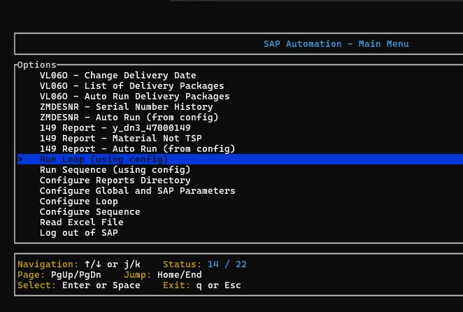

# SAP Automation

A Rust-based utility for automating SAP GUI interactions.

## Description

This project provides tools for automating SAP GUI operations using Rust. It leverages the Windows COM interface to interact with the SAP GUI Scripting API, allowing for programmatic control of SAP sessions.

Key features include:

- Automated SAP login with credential management
- Secure storage of encrypted credentials
- Handling of multiple logon scenarios
- Interaction with SAP GUI controls (buttons, text fields, checkboxes, etc.)
- Management of popups and error messages
- Support for transaction code execution and verification
- Data export capabilities
- Per-tcode configuration management
- **Command-line interface for unattended automation**
- **Loop and sequence execution without user interaction**

## Terminal User Interface (TUI)

This application features a modern terminal user interface built with [ratatui](https://github.com/ratatui-org/ratatui), providing an intuitive and responsive menu system for navigating SAP automation features.

### TUI Features

The TUI provides:

- **Interactive Menu Navigation**: Easy-to-use selection menus for all application features
- **Real-time Status Display**: Shows current selection position and total items
- **Responsive Design**: Adapts to different terminal sizes
- **Keyboard Shortcuts**: Efficient navigation using familiar key combinations

### Menu Example

The application presents a clean, organized menu interface for selecting SAP automation operations:



The menu displays:

- **Title Bar**: Shows the current menu context
- **Selection List**: Available options with highlighted current selection
- **Status Bar**: Current position and total items
- **Navigation Instructions**: Quick reference for available controls

### Navigation Controls

The TUI supports the following navigation controls:

| Action             | Keys                    |
| ------------------ | ----------------------- |
| **Move Up**        | `↑` (Up Arrow) or `k`   |
| **Move Down**      | `↓` (Down Arrow) or `j` |
| **Page Up**        | `PgUp`                  |
| **Page Down**      | `PgDn`                  |
| **Jump to Top**    | `Home`                  |
| **Jump to Bottom** | `End`                   |
| **Select Item**    | `Enter` or `Space`      |
| **Exit/Cancel**    | `q` or `Esc`            |

### TUI Components

The TUI system includes several specialized components:

- **Selection Menus**: Standard list-based selection for choosing operations
- **Grid Menus**: Alternative grid layout for better organization of many options
- **Input Dialogs**: Text input prompts for configuration and data entry

All TUI components maintain consistent navigation patterns and visual styling for a cohesive user experience.

## Command Line Interface (CLI)

The application also supports command-line operation for automation scenarios. This allows you to run SAP automation tasks without any user interaction, making it perfect for:

- **Scheduled tasks and batch processing**
- **CI/CD pipeline integration**
- **Automation scripts**
- **Testing and validation**

### Three Execution Modes

| Mode | Trigger | Description |
| --- | --- | --- |
| **Loop** | `run-loop` subcommand or `--run-loop` flag | Repeats a single TCode auto-flow on a timer (uses `[loop]` config). |
| **Sequence** | `run-sequence` subcommand or `--run-sequence` flag | Runs a list of menu options in order on a timer (uses `[sequence]` config). |
| **Single-shot** | `--tcode=<X>` on its own | Runs the auto-flow for one TCode once and exits. |

### Quick Examples

```bash
# Show help (lists every flag)
./sap_automation.exe --help

# Loop the configured TCode (uses [loop] from config.toml)
./sap_automation.exe run-loop
./sap_automation.exe --run-loop

# Headless report (all SAP steps + TSV outputs); see COMMAND_LINE_USAGE.md
./sap_automation.exe --rname=mustgo --run-date=2026-11-05
./sap_automation.exe --rname=mustgo --run-date=WK45
./sap_automation.exe --rname=xdock --run-date=2026-11-05
./sap_automation.exe --rname=toyota --run-date=2026-11-05
./sap_automation.exe --rname=misc --run-date=2026-11-05
./sap_automation.exe --rname=k2xx --run-date=2026-11-05
./sap_automation.exe --rname=relabel --run-date=2026-11-05   # run k2xx for the same date first
./sap_automation.exe --rname=repack --run-date=2026-11-05    # run k2xx, then relabel for the same date first

# Per-day iteration over a week/range, optionally one merged xlsx per report (see "Per-day iteration" below)
./sap_automation.exe --rname=xdock --run-date=WK40 --loop --merge
./sap_automation.exe --rname=xdock --run-date=WK40 --loop

# Also write an .xlsx workbook next to the TSV files of a single run
./sap_automation.exe --rname=xdock --run-date=2026-11-05 --output-format=xlsx

# Fill multi-selection popups (deliveries, shipments, TOs, ...) from the clipboard instead of Page Down (off by default)
./sap_automation.exe --rname=mustgo --run-date=2026-11-05 --use-clipboard
./sap_automation.exe --tcode mm60 --layout <L> --use-clipboard

# Sequence (uses [sequence] from config.toml)
./sap_automation.exe run-sequence
./sap_automation.exe --run-sequence

# Single-shot run of VT11 with overrides; no config.toml required
./sap_automation.exe --tcode=vt11 --layout=my_layout --variant=my_variant --export-type=1

# Override loop timing + iterations from CLI; flags win over config
./sap_automation.exe --run-loop --tcode=vt11 --iterations=3 --delay-seconds=30

# 149 regular plant-loop (omit run-type / none); or rcv|mat|tsp for sub-flows
./sap_automation.exe --tcode=y_xx_99999999 --plants=PLT1,PLT2
./sap_automation.exe --run-loop --tcode=y_xx_99999999 --tcode-run-type=rcv

# Filter VT11 by an arbitrary delivery list and date range
./sap_automation.exe --tcode=vt11 --by-delivery=true \
  --delivery-file=C:\out\dn.csv --delivery-col="Delivery Number" \
  --by-date=true --date-start=2026-02-01 --date-end=2026-02-15
```

### CLI vs config.toml

CLI flags **always win** over `config.toml`, and they work even when `config.toml` is missing. When at least one override is in play, the runner prints a one-line summary like
`CLI overrides applied (these win over config.toml): --tcode=VT11 --iterations=3` so you can see what's being applied before the SAP work starts.

`--run-sequence` is intentionally config-driven — passing per-tcode flags (`--tcode`, `--layout`, `--by-date`, etc.) with `--run-sequence` is rejected up-front so you don't accidentally apply VT11 settings to a multi-tcode run.

### Key Benefits

- **No User Interaction**: Runs completely automatically
- **Configuration Driven**: Uses your existing `config.toml` settings; CLI flags can override any value
- **Error Handling**: Clear error messages and exit codes; missing required flags fail fast (e.g. missing `--tcode` for loop runs)
- **Logging**: All output goes to console for easy logging
- **Backward Compatible**: Interactive mode remains unchanged

For the full flag reference, validation rules, source-file resolution, and end-to-end examples, see [COMMAND_LINE_USAGE.md](COMMAND_LINE_USAGE.md).

### ABC Headless reports

`--rname=<name> --run-date=<DATE|A..B|WKnn>` runs a whole report unattended (today: `mustgo`, `xdock`, `toyota`, `misc`, `k2xx`, `relabel` and `repack`): the SAP exports are forced to
text with tabs, loaded, post-processed offline and written as TSV under `<reports_dir>\K2XX\<today>\mustgo\` (`mustgo`) or
`<reports_dir>\INV\<today>\xdock\` (`xdock`: VT11, VL06O, ZMDETPC, merged `vl06o` table and plant pivot; `toyota` the same under `...\toyota\` plus a trailers table; `misc`: VT11, VL06O and a pivot of packages by shipping point, no ZMDETPC). `k2xx` writes to `<reports_dir>\K2XX\<today>\k2xx\`
(VT11, VL06O layout `VL06O_K2XX_LAYOUT`, ZVT11 Closed, ZMDETPC; outputs `zvt11`, `vt11`, the merged `vl06o` table and a plant pivot of its `total`); it has run against live SAP and is golden-tested on real exports. `relabel` needs a single run date and the output of `k2xx` for the same date and day (it reads the `VL06O` table `k2xx` wrote); it runs ZMDESNR by deliveries and by serial / History and writes `combined`, `sn_del`, `snr_orig` and a pivot of the label counts to `<reports_dir>\K2XX\<today>\relabel\` (also run against live SAP; golden-tested on real exports). `repack` needs a single run date and the output of `k2xx` **and** `relabel` for the same date and day (the deliveries of the `VL06O` table and the `yellow` rows of `combined`); it runs ZMDESNR by deliveries excluding the yellow serials as parents and by serial / History, and writes `snr_repack`, `repack_sn` and a pivot (count by customer and plant) to `<reports_dir>\K2XX\<today>\repack\` (golden-tested on real exports; not run against live SAP yet). In the TUI they are
the first entries of the **ABC Headless** submenu (main menu option 30); it asks for the run date and runs the same code. There is
deliberately **no sequence menu id** for them: the sequence runner is config-driven and has no run date. Options live in the
optional `[abc.mustgo]` / `[abc.xdock]` / `[abc.toyota]` / `[abc.misc]` / `[abc.k2xx]` / `[abc.relabel]` / `[abc.repack]` sections ([CONFIG.md](CONFIG.md)); flags, exit codes and file locations are in
[COMMAND_LINE_USAGE.md](COMMAND_LINE_USAGE.md). The SAP steps have not been verified on a live system yet; see the live
verification checklist in `docs/private/abc_headless_plan.md`.

### Per-day iteration (`--loop`, `--merge`)

`--rname=<name> --run-date=<A..B|WKnn> --loop` runs the report once **per day** of the range or week (all 7 days of `WKnn`,
Sunday-Saturday) instead of one run over the whole range; a single date with `--loop` is an error. Add `--merge` to combine the
per-day outputs afterwards (`--merge` requires `--loop`; `--loop` alone leaves the individual per-day runs). The TUI **ABC Headless**
submenu asks for both (y/N).

```bash
./sap_automation.exe --rname=xdock --run-date=wk40 --loop --merge
./sap_automation.exe --rname=repack --run-date=wk40 --loop --merge --output-format=xlsx
```

* **Chain:** per day the prerequisites run first: `k2xx`, then `relabel`, then `repack` (`--rname=repack` runs all three each day). The
  other reports have no prerequisites.
* **Merge:** one `<DATE>_<RNAME>_MERGED.xlsx` per report of the chain (e.g. repack yields k2xx, relabel and repack files), next to
  the per-day files in `<reports_dir>\<K2XX|INV>\<today>\<rName>\` (`<DATE>` is `WK_<n>` for a week). Its sheets are **all output
  tables** of the report (including the pivot), the per-day tables concatenated with a leading `run_date` column (ISO
  `yyyy-mm-dd`). The per-day TSV files keep their `MM-DD-YYYY` names; TSV stays the canonical output.
* **`weekly_pivot` sheet:** every merged workbook gets one extra computed sheet **after** the report's own sheets (plain values, not a native
  PivotTable): rows = one per day (`export_date` if the source table has it, else the ISO `run_date`; ascending when ISO, otherwise first-appearance
  order), columns = the plants A-Z (case-insensitive; a blank plant is `(blank)`, last), cells = the same measure as the report's per-day pivot
  (`total` summed over `vl06o` for xdock/toyota/k2xx, `number_of_packages` for misc, `_of_labels` over `combined` for relabel, row count over
  `snr_repack` / `snr_copy` for repack / mustgo; relabel and repack drop the customer dimension here), `0` for empty combinations, plus a `Total`
  column and row. If the source table is empty or lacks a column the sheet is skipped with a note and the merge still succeeds.
* **Failures:** a day with no data (`NO DATA`) is logged and skipped (the rest of that day's chain is not run); any other error stops
  the whole iteration, **no merge** is written and the per-day files already written stay. A summary lists the days done, skipped
  and failed. If every day was skipped there is nothing to merge (no merge, no error).
* **Pivot sheets** are wide cross-tabs whose plant columns depend on the day, so they are unioned across days (blank where a plant
  had no data); every other table must have identical headers on all days. If a merge fails the full summary is still printed,
  reports that merged keep their workbooks, and the process exits non-zero ("N merge(s) failed").
* `--output-format=xlsx` (default `tsv`) on a single run also writes `<DATE>_<RNAME>.xlsx` with every output table as a sheet.
* **Not related** to `--run-loop`, `--run-sequence` or `--iterations`, which repeat the config-driven TCode loop/sequence; `--loop`
  and `--merge` only apply together with `--rname` and cannot be combined with those flags.

#### Reusing existing outputs (`--no-sap`, `--skip-existing`, `--output-date`)

Work on the per-day **TSV files** only (nothing is re-processed from raw exports). A day+report is **complete** when ALL of its output
tables exist as files (header-only files count; a partial set is incomplete) - the same rule the merge uses.

* `--output-date=YYYY-MM-DD`: the date folder (`<reports_dir>\<folder>\<DATE>\<rName>\...`) to read and write instead of today's. Applies
  to single runs, `--loop`, `--merge`, `--skip-existing` and `--no-sap`; `relabel` / `repack` re-read the k2xx / relabel TSVs from the same folder.
  Without it the real today is used (unchanged behaviour).
* `--skip-existing` (resume): each complete day+report is logged "exists, skipped" and not run; incomplete ones run in SAP (and overwrite).
  Skipped days still count as done and are merged. Also works for a single run. When everything is already complete SAP is not connected
  at all. A `NO DATA` day writes no files, so it is tried again on every resume.
* `--no-sap`: strict offline, no SAP session is created (SAP GUI may be closed). Needs `--rname`. Every day and every report of the chain
  (prerequisites too) must be complete, else ONE error lists the missing day / report / tables and nothing is merged. With `--loop --merge` it
  re-merges an exported week; with `--loop` alone, or a single date, it only verifies the files. Not with `--skip-existing`; with
  `--output-format=xlsx` it is an error (the per-day workbook is not regenerated offline; `--merge` always writes its xlsx).
* `--with-prereqs` (single runs): also covers the report's own prerequisite chain for that one date, in order (relabel: k2xx, relabel;
  repack: k2xx, relabel, repack), never anything downstream (relabel does not run repack). Without the flag a single run checks / runs only
  the report itself. No data in a chain member skips the rest of the chain for that date (reported, not an error). Combined with
  `--skip-existing` only the incomplete chain members run (all complete: SAP is not connected). Combined with `--no-sap` EVERY chain member must
  be complete on disk, else ONE error lists each missing report and its tables (nothing can be generated without SAP); if all are present it
  prints "ready". Needs `--rname`. With `--loop` it is accepted but has no extra effect (the loop already includes the prerequisites).
* Unlike `--run-loop` / `--run-sequence` / `--iterations` (config-driven TCode repetition) these flags only reuse or redirect `--rname` outputs.
* Not in the TUI (also not `--with-prereqs`).

```
./sap_automation.exe --rname=xdock --run-date=wk46 --loop --merge --no-sap --output-date=2026-11-12   # re-merge with SAP closed
./sap_automation.exe --rname=xdock --run-date=wk46 --loop --merge --skip-existing --output-date=2026-11-12   # resume after a stop
./sap_automation.exe --rname=repack --run-date=2026-11-05 --with-prereqs                 # k2xx, relabel, repack for one date
./sap_automation.exe --rname=repack --run-date=2026-11-05 --with-prereqs --no-sap --output-date=2026-11-12   # verify all three exist
```

Not verified on a live system yet (including the reuse flags); see `docs/private/abc_iteration_plan.md`.

#### Parallel SAP sessions (`--multi-conn`, `--conn-count`)

Opt-in; without these flags nothing changes. The tool opens extra windows (sessions) on the first SAP connection, runs work in them at the same
time (one thread and one COM instance per session) and closes them again at the end.

* `--rname=xdock --rname=k2xx --run-date=<date> --multi-conn`: one session per report, all at once.
* `--rname=k2xx --run-date=WK46 --loop --multi-conn`: one session per day of the range (at most 6, fewer if windows are already open).
* `--rname=k2xx --run-date=WK46 --loop --conn-count=3`: exactly 3 sessions share the days from a queue: a session that finishes a day takes the
  next one (sessions are reused, not respawned). With `--merge` the merge runs once at the end, without SAP.
* SAP allows 6 sessions per connection **including your own open windows**. No `--use-clipboard` (one shared clipboard) and no `--no-sap`.
* Export files carry the session number (`20261112162255-s3_VT11.txt`); console lines are prefixed `[s3]` and written asynchronously.
* A day without data is skipped; any other error stops new days, running ones finish, nothing is merged. A summary table lists every job.

* **Status panel (v0.17.0):** on a terminal, a grid stays pinned below the scrolling output: a header (elapsed time, `days done/total`, active sessions) and one row per session with its state (`running` / `done` / `FAILED`), its task (`toyota for 2026-01-09`), a per-row timer and its latest log line. Output redirected to a file or pipe is unchanged; set `SAP_NO_STATUS=1` to switch the panel off.

Live-verified for two reports (xdock + k2xx) and for days of a range (`--conn-count`); see [COMMAND_LINE_USAGE.md](COMMAND_LINE_USAGE.md).

## Sequence Menu Option IDs

These IDs match the current main menu and can be used in the sequence configuration:

- 2: VT11 - Auto Run
- 4: VT11 - ListCheck Auto
- 6: ZEXVT11 - Auto Run
- 8: VL06O - Auto Run
- 11: VL06O - Delivery Packages Auto Run
- 13: ZEXSNR - Auto Run
- 18: 149 Report - Auto Run
- 19: Inbond - Shipment to 149

### Inbond - Shipment to 149

Interactive clerk flow (menu option **Inbond - Shipment to 149**):

1. Prompt for a shipment number
2. Run **VL06O** with variant from `[inbond].vl06o_variant` (default `blank_`)
3. Export the delivery list, parse and **dedupe** delivery numbers
4. Run **y_xx_99999999** with variant/layout `INB_149_NAME` (configurable), paste deliveries into `S_DELIV`
5. Export a timestamped paste-ready `.txt` and open it in Notepad

Clerk then pastes the file into `material.php` `#clipboard`, types the shipment into `#shipmentInput`, and clicks `#splitBtn`.

This path does **not** use `exec_rest` (no browser/GUI upload).

```toml
[inbond]
vl06o_variant = "blank_"
variant_149 = "INB_149_NAME"
layout_149 = "INB_149_NAME"
layout_columns = [
  "Plant",
  "Delivery Number",
  "Material",
  "Quantity",
  "UOM",
  "Logistics Reference Number"
]
export_type = 1
open_notepad = true
```

If `layout_149` is missing in SAP (or empty), the flow sets up `layout_columns` via Change Layout and asks whether to save under that name (default `INB_149_NAME`). When you confirm and SAP save succeeds, `[inbond].layout_149` is written/updated in `config.toml` so the next run uses the confirmed name.

## Dependencies

This project relies on the following key dependencies:

- `sap-scripting` - A Rust library for interacting with SAP GUI Scripting API, created by Lily Hopkins (https://github.com/lilopkins/sap-scripting-rs)
- `windows` - For Windows COM interface integration
- `aes-gcm` and `base64` - For secure credential encryption
- `dialoguer` and `crossterm` - For terminal UI components
- `toml` and `serde` - For configuration file parsing and serialization

## Configuration

### Setting Up Your Configuration

The application uses a `config.toml` file for configuration. To get started:

1. Copy the example configuration file:

   ```
   copy config.toml.example config.toml
   ```

2. Edit the `config.toml` file to match your environment and requirements

### Configuration System

The configuration system has been redesigned to support:

- Global settings that apply to all operations
- Per-tcode settings that apply only to specific transaction codes
- Loop operation settings for automated repetitive tasks

For detailed information about the configuration system, see [CONFIG.md](CONFIG.md).

### Configuration Sections

The configuration file is divided into several sections:

#### [build] Section

- `target` - Specifies the build target architecture (e.g., `i686-pc-windows-msvc` for 32-bit Windows)

#### [global] Section

- `instance_id` - SAP instance identifier (default: "rs")
- `reports_dir` - Directory where reports will be saved (default: User's Documents\Reports folder)
- `default_tcode` - Default transaction code to execute (e.g., "VL06O")

#### [tcode.XXX] Sections

Each transaction code can have its own configuration section:

```toml
[tcode.VT11]
variant = "testing_7"
layout = "my_layout"
date_range_start = "01/01/2023"
date_range_end = "12/31/2023"
```

#### [loop] Section

Configuration for loop operations:

```toml
[loop]
tcode = "VT11"
iterations = "4"
delay_seconds = "15"
```

### Migration from Legacy Format

If you're upgrading from a previous version, you can use the migration tool to convert your configuration file to the new format:

```
cargo run --bin migrate_config
```

## Usage

The main binary provides a simple interface for logging into SAP:

```
cargo run --bin sap_login
```

This will present a menu with options to log in to SAP, with support for saving encrypted credentials for future use.

The application looks for credentials in the user's Documents folder under `SAP/cryptauth_*.txt`. The instance ID can be configured via the `SAP_INSTANCE_ID` environment variable or in the configuration file.

## Line Endings

This project uses Git's line ending normalization to ensure consistent behavior across different operating systems. The `.gitattributes` file configures:

- Automatic line ending normalization for most text files
- LF (Unix-style) line endings for shell scripts (\*.sh)
- CRLF (Windows-style) line endings for batch files (\*.bat)

If you encounter line ending issues when committing changes, make sure you have the `.gitattributes` file in your repository.
